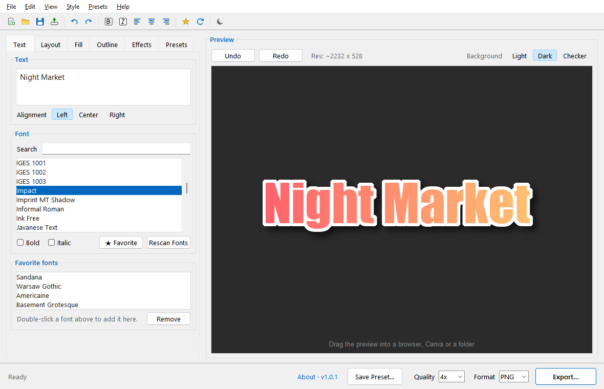
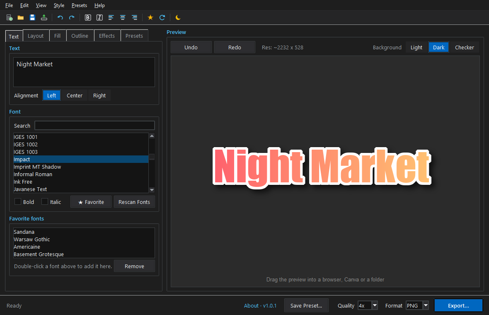
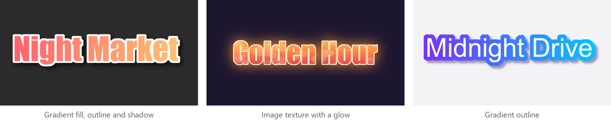

<p align="center">
  
</p>

<h1 align="center">CK Text Artist</h1>

<p align="center">
  Style text with any installed font, fills, outlines and shadows,<br>then export it as PNG, JPG or SVG, or drag it straight into another app.
</p>

<p align="center">
  <a href="https://github.com/project-ceekay/ck-text-artist/releases/latest"></a>
  <a href="https://github.com/project-ceekay/ck-text-artist/releases"></a>
  
  <a href="LICENSE"></a>
</p>

<p align="center">
  <a href="https://github.com/project-ceekay/ck-text-artist/releases/latest"><b>Download</b></a> ·
  <a href="https://cksoftware.netlify.app/text-artist.html">Website</a> ·
  <a href="CHANGELOG.md">What's new</a> ·
  <a href="https://cksoftware.netlify.app/">More CK Software</a>
</p>

<p align="center">
  
  
</p>

Part of the **CK Suite**, a set of small, free Windows tools by [CK Software](https://cksoftware.netlify.app/).

## Features

### Fonts and text
- **Every installed font**, with search and favourites, plus bold and italic
- **Layout:** left, centre or right alignment, character and line spacing, squash and stretch,
  and rotation

### Style
- **Fills and outlines** in a colour, a gradient or an image texture, with texture filters
- **Drop shadow or glow** with colour, opacity, offset and blur
- **Presets** with thumbnails, so a look you like is one click away next time



### Export
- **PNG, JPG or SVG** at up to 4× quality
- **Drag the preview** straight into a browser, Canva or a folder
- **Undo and redo** for every change

### Comfortable to use
- **Top Menu Bar & Toolbar:** Classic menus (`File`, `Edit`, `View`, `Style`, `Presets`, `Help`) with 2×-supersampled procedural icons, hover tooltips, and active font name in the title bar
- **Light & Dark Mode:** Native theme toggle from the toolbar or **View → Dark Mode**, with dark title bar styling (persisted across launches)
- **Live preview** on a light, dark or checkerboard background
- **Smooth window resizing:** the window keeps up with the mouse while you drag its edge and lays
  itself out once when you let go
- **Keyboard shortcuts** for the common actions (see below)

## Download

**[Download the latest version](https://github.com/project-ceekay/ck-text-artist/releases/latest)**:
get the `…-Setup.exe` file under *Assets* and run it.

- Windows 10 or 11 (64-bit). Installs for your user account only, so no administrator rights are needed.
- Windows may show **"Windows protected your PC"** because the installer isn't code-signed.
  Click **More info → Run anyway**.
- Uninstall any time from **Settings → Apps**.

## How to use it

1. Type your text and pick a font on the **Text** tab.
2. Style it on the **Layout**, **Fill**, **Outline** and **Effects** tabs.
3. Click **Export…** (Ctrl+E), or drag the preview out of the window.

### Keyboard shortcuts

| Keys | Action |
|---|---|
| Ctrl+Z | Undo |
| Ctrl+Y or Ctrl+Shift+Z | Redo |
| Ctrl+E | Export |
| Ctrl+S | Save a preset |
| Ctrl+O | Show presets |

## Updates

The program checks GitHub for a new version once a day. When one is available, a link appears at
the bottom of the window: click it to read what's new and update in one click. Your settings are
kept. You can turn the automatic check off under **About**.

Settings, presets and the font list cache are stored in `%APPDATA%\CK Suite\Text Artist`. If you
used CK Text Editor before, your favourites and presets are copied over the first time you start it.

## Privacy

CK Text Artist only goes online for the daily update check (GitHub's releases API), which you can
turn off under **About**. Your text, fonts and designs never leave your computer.

## Run or build from source

Requires Python 3.10 or newer.

```
pip install -r requirements.txt
python program.py
```

To build the installer yourself: `pip install pyinstaller`, run the PyInstaller command from
[`.github/workflows/release.yml`](.github/workflows/release.yml), then compile
[`installer/setup.iss`](installer/setup.iss) with [Inno Setup](https://jrsoftware.org/isinfo.php).
Releases are built automatically by GitHub Actions when a version tag (`v1.2.3`) is pushed.

## Credits

- [Pillow](https://github.com/python-pillow/Pillow) draws the text and effects
- [fontTools](https://github.com/fonttools/fonttools) reads font files and makes the SVG export
- [tkinterdnd2](https://github.com/Eliav2/tkinterdnd2) lets you drag the preview out of the window

## License

CK Text Artist's own code is [MIT](LICENSE) licensed, © CK Software. Bundled third-party
components and their licenses are listed in [THIRD-PARTY-NOTICES.md](THIRD-PARTY-NOTICES.md).
